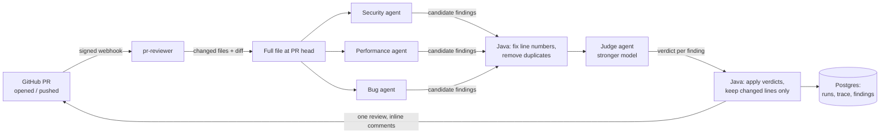
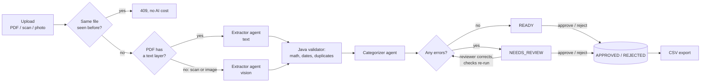

# AgentForge

**Two AI agent applications built with Java 21, Spring Boot and LangChain4j.** Each one shows a different way to orchestrate agents:

| App | What it does | Orchestration pattern |
|---|---|---|
| [**PR Reviewer**](#pr-reviewer) | Reviews GitHub pull requests and posts inline comments | **Parallel** specialists, then a **judge** |
| [**Invoice Processor**](#invoice-processor) | Reads PDF, scanned and photographed invoices; validates, categorizes and exports them | **Sequential** pipeline with **human review** |

<!-- TODO: add a screenshot of a review on a PR as docs/review-example.png, then:
 -->

**Stack:** Java 21 (virtual threads) · Spring Boot 3.5 · LangChain4j · OpenAI (text + vision) · PostgreSQL + Flyway · PDFBox · Docker Compose · Testcontainers

**The rule both apps follow:** *the LLM does only what needs an LLM.* Reading messy text, judging code and categorizing are done by agents. Arithmetic, line numbers, diff parsing, duplicate checks and state changes are plain Java: exact, free, instant and unit-tested. Where an LLM can be wrong, Java checks it.

---

## Quick start

You need **Docker** and an **OpenAI API key**.

```bash
cp .env.example .env          # then put your OPENAI_API_KEY in .env
docker compose up -d --build
```

| Service | URL |
|---|---|
| PR Reviewer | http://localhost:8090 |
| Invoice Processor | http://localhost:8091 |
| PostgreSQL | `localhost:5433` (default user and password: `agentforge`) |

---

## PR Reviewer

Open a pull request, and three specialist agents (security, performance, bugs) review the changed files in parallel. A judge agent running on a stronger model checks their findings, drops false positives and fixes severities. The result is posted as one GitHub review with inline comments, only on the lines the PR actually changed.



1. **GitHub sends a signed webhook** when a PR is opened or gets new commits. The app checks the HMAC-SHA256 signature, answers `202` straight away, and reviews in the background (GitHub times out after 10 s; a review takes 10–30 s).
2. **Agents read the whole file, not just the diff,** so they understand the context. Each returns typed Java records through OpenAI structured output.
3. **The specialists run in parallel** on virtual threads: a review takes about as long as the slowest agent.
4. **Java cleans up their output:** it corrects off-by-one line numbers using the code each finding quotes, and removes duplicates.
5. **The judge** (gpt-4.1; the specialists use gpt-4o-mini) returns keep/drop, the right severity and a reason for every finding.
6. **Only lines the PR changed get comments,** and a new push only reviews lines changed since the previous one.
7. **Every run is stored:** the agent trace, every finding, and what the judge dropped and why.

| Decision | Why |
|---|---|
| Several focused agents instead of one | On the same test file one generalist found 3 issues; the specialists found 7–8, in less time because they run in parallel. |
| The judge returns verdicts, Java applies them | Every drop has a stored reason, and a finding the judge forgets to mention is kept, not silently lost. |
| A stronger model only for the judge | One call per file makes a better model affordable. With gpt-4o-mini as judge it dropped findings for the wrong reasons; gpt-4.1 didn't. |
| Comment only on changed lines | Only fair to flag what the PR introduced, and GitHub rejects inline comments outside the diff. Older problems are stored, not posted. |
| Failures don't sink a review | A failed agent or judge falls back to the other results; a crashed background review leaves a `FAILED` row. |

### Using it

Review pasted code:
```bash
curl -X POST http://localhost:8090/api/review -H "Content-Type: application/json" \
  -d '{"language": "Java", "code": "String q = \"SELECT * FROM users WHERE name = '\''\" + name + \"'\''\";"}'
```

Review a pull request. Create a **fine-grained token** with **Pull requests: Read and write** and **Contents: Read-only** and set `GITHUB_TOKEN` in `.env`. Dry runs on public repos work without a token.
```bash
curl -X POST "http://localhost:8090/api/github/OWNER/REPO/pulls/1/review?dryRun=true"   # dryRun=false posts it
```

**Automatic reviews:** GitHub can't reach your laptop, so a [smee.io](https://smee.io) relay forwards webhooks:
1. Get a channel at https://smee.io/new, and set `SMEE_URL` and a long random `GITHUB_WEBHOOK_SECRET` in `.env`.
2. In your repo, go to **Settings → Webhooks → Add webhook**: payload URL = the smee URL, content type `application/json`, the same secret, events **Pull requests** only.
3. Run `docker compose --profile webhook up -d`.

| Endpoint | What it does |
|---|---|
| `POST /api/review` | Review pasted code. `?mode=team` (default) or `single`, `?judge=false` |
| `POST /api/github/{owner}/{repo}/pulls/{n}/review` | Review a PR. `?dryRun=true` (default), `?since=<sha>` |
| `POST /api/github/webhook` | GitHub webhook receiver (signature required) |
| `GET /api/runs`, `GET /api/runs/{id}` | Review history with agent trace and all findings |

---

## Invoice Processor

Upload an invoice (a PDF, a scanned PDF, or a photo) and get structured, checked, categorized data back. Anything suspicious goes to a review queue, where a person can correct misread values, approve or reject it. Approved invoices export to CSV.



1. **The file type is detected from its bytes** (`%PDF`, PNG and JPEG signatures), never from the file name.
2. **Digital PDFs are read as text** (PDFBox): cheaper and exact. **Scans and photos go to the vision model** as page images.
3. **The Extractor copies values exactly as printed and never calculates.** If an invoice is wrong, the validator needs the wrong number. It handles US and European formats (`1,250.00`, `1.250,00 €`, `15.09.2026`).
4. **The validator is plain Java:** quantity × price, line sum vs subtotal, subtotal + tax vs total (1-cent tolerance), required fields, and *plausibility*: a 1,475-day payment term means a misread year.
5. **The Categorizer** assigns one of 12 bookkeeping categories per line.
6. **Duplicates are caught twice:** the same file by its SHA-256 hash (refused before any AI call), and the same vendor + invoice number from a different file (for example the PDF *and* a photo of the paper copy).

| Decision | Why |
|---|---|
| Validation in Java, not an agent | Arithmetic is exact and takes ~1 ms in Java; LLMs are unreliable at it. Every misread in testing was caught by these checks: a quantity of 5 read as 0.5, a year 2026 read as 2022, an amount 15 read as −15. |
| Text first, vision only when needed | Reading the PDF's text layer is cheaper and exact; vision is used only for scans and photos. |
| Images passed as `@UserMessage List<Content>` | Passing a whole `UserMessage` object to a LangChain4j AI Service turns it into text with `toString()`: the model gets base64 characters instead of an image and quietly returns empty data. |
| Corrections re-run the checks | Fixing a misread value recalculates the status with no AI calls; every change is kept in an audit table with the reviewer's note. |
| Decisions are final and race-safe | The "still open?" check is part of the SQL `UPDATE`. Approving an invoice that failed checks requires a written note. |
| Its own Postgres schema | Same database as the PR reviewer, but a separate `invoices` schema with its own Flyway history, so both apps' migrations start at V1 without clashing. |

### Using it

Sample invoices are in [samples/invoices/](samples/invoices/): digital PDFs, a photo and a scanned PDF, each with its saved result.

```bash
# Upload (PDF, PNG or JPEG)
curl -F "file=@samples/invoices/cloudnest-invoice.pdf" http://localhost:8091/api/invoices/process

# The review queue
curl "http://localhost:8091/api/invoices?status=NEEDS_REVIEW"

# Correct a misread value; the checks run again
curl -X PATCH http://localhost:8091/api/invoices/4 -H "Content-Type: application/json" \
  -d '{"note": "year misread on the scan", "issueDate": "2026-09-15", "lines": [{"line": 3, "amount": 15.00}]}'

# Approve (a note is required if the invoice failed checks) or reject (always needs a note)
curl -X POST http://localhost:8091/api/invoices/1/approve
curl -X POST http://localhost:8091/api/invoices/2/reject -H "Content-Type: application/json" \
  -d '{"note": "Line 2 overcharged, asked the vendor for a corrected invoice"}'

# Approved invoices as CSV, one row per line item
curl -o approved-invoices.csv "http://localhost:8091/api/invoices/export.csv?from=2026-09-01&to=2026-12-31"
```

| Endpoint | What it does |
|---|---|
| `POST /api/invoices/process` | Upload and process an invoice (multipart field `file`) |
| `GET /api/invoices` | List invoices, `?status=READY / NEEDS_REVIEW / APPROVED / REJECTED` |
| `GET /api/invoices/{id}` | Invoice with lines, issues, review note and correction history |
| `PATCH /api/invoices/{id}` | Correct values (only the fields you send); the checks run again |
| `POST /api/invoices/{id}/approve` | Approve. `{"note": "..."}` required if it's `NEEDS_REVIEW` |
| `POST /api/invoices/{id}/reject` | Reject with `{"note": "..."}` |
| `GET /api/invoices/export.csv` | Approved invoices as CSV, optional `?from=` and `?to=` (issue date) |

The CSV is safe to open in a spreadsheet: values are escaped, and text starting with `=`, `+`, `-` or `@` is neutralised, so it can't run as a formula.

---

## Configuration

All settings come from `.env` (see [.env.example](.env.example)):

| Variable | Default | Used by | Purpose |
|---|---|---|---|
| `OPENAI_API_KEY` | required | both | OpenAI key |
| `OPENAI_MODEL` | `gpt-4o-mini` | both | Model for the specialists, extractor and categorizer |
| `OPENAI_JUDGE_MODEL` | `gpt-4.1` | PR reviewer | Model for the judge |
| `GITHUB_TOKEN` | empty | PR reviewer | Needed for private repos and to post reviews |
| `GITHUB_WEBHOOK_SECRET` | empty | PR reviewer | Webhook signature secret; empty rejects every webhook |
| `SMEE_URL` | empty | PR reviewer | Webhook relay channel (only with `--profile webhook`) |
| `REVIEW_MAX_FILES` / `REVIEW_MAX_LINES` | `5` / `800` | PR reviewer | Cost limits per PR (each file costs 4 LLM calls) |
| `INVOICE_MAX_PAGES` | `3` | Invoice processor | Pages of a scanned PDF sent to the vision model |
| `APP_PORT` / `INVOICE_APP_PORT` | `8090` / `8091` | — | Ports on your machine |

**Rough costs:** a PR review of a ~50-line file is 1–2 cents (mostly the judge). An invoice is well under a cent from text, and a bit more from a scan or photo (image tokens).

## Development

Run only the database in Docker and the apps from your IDE:

```bash
docker compose up -d postgres
```

```powershell
. .\use-java21.ps1                       # switches only this terminal to Java 21 (Windows)
mvn -pl pr-reviewer spring-boot:run
mvn -pl invoice-processor spring-boot:run
```

Both apps read `.env` from the repo root. In pgAdmin (`localhost:5433`), the PR reviewer's tables are in the `public` schema and the invoice processor's are in `invoices`.

### Tests

```bash
mvn test
```

- **Unit tests** cover the deterministic logic: line correction, deduplication, judge verdicts, diff parsing and webhook signatures (checked against GitHub's own example) for the reviewer; invoice math and plausibility, file type detection, scanned-PDF rendering, corrections and CSV escaping for the invoices.
- **Repository tests run against a real Postgres** started by Testcontainers, so Docker must be running.

### Project layout

```
pr-reviewer/src/main/java/dev/agentforge/prreviewer/
├── review/           orchestration (parallel agents + judge), findings, reports
│   └── agents/       specialist and judge agents, shared prompts, judge model config
├── github/           GitHub client, diff parser, PR pipeline, webhook + signature check
└── runs/             review history (JdbcClient) and /api/runs

invoice-processor/src/main/java/dev/agentforge/invoices/
├── extract/          file type detection, PDF text, page rendering for scans
├── agents/           extractor (text + vision) and categorizer agents
├── validate/         invoice math and plausibility checks
├── pipeline/         the sequential pipeline and the REST API
└── store/            persistence, duplicates, approvals, corrections, CSV export

*/src/main/resources/db/migration/   Flyway migrations per app
samples/                              buggy code, sample invoices, saved results
```

## Known limitations

- **LLM output varies from run to run.** The same file can get different findings, and a scan can be misread differently each time. The Java checks catch inconsistent values, but a misread that still adds up would pass.
- **PR review comments are posted under the token owner's account.** Posting as a bot needs a GitHub App.
- **Webhook reviews aren't retried;** a failed one is recorded as `FAILED`.
- **Invoice corrections can change existing lines but not add or remove them.**
- **There is no login:** the APIs are meant to run locally or behind your own authentication.

## Roadmap

- [x] PR Reviewer: parallel specialists + judge, GitHub reviews, signed webhooks, review history
- [x] Invoice Processor: text and vision extraction, Java validation, categories, duplicates, review queue with corrections, CSV export
- [ ] Evaluation suite: known-bug and known-invoice samples, scored automatically across repeated runs
- [ ] `agentforge-core`: extract the shared agent/pipeline engine from both apps
- [ ] Trace and cost dashboard, GitHub App, deployment
