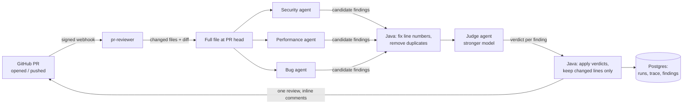

# AgentForge

**A multi-agent AI code reviewer for GitHub pull requests, built with Java 21, Spring Boot and LangChain4j.**

Open a pull request, and three specialist AI agents (security, performance, bugs) review the changed files in parallel. A judge agent running on a stronger model checks their findings, drops false positives and fixes severities. The result is posted as one GitHub review with inline comments, only on the lines the PR actually changed.

<!-- TODO: add a screenshot of a review on a PR as docs/review-example.png, then:
 -->

**Stack:** Java 21 (virtual threads) · Spring Boot 3.5 · LangChain4j · OpenAI · PostgreSQL + Flyway · Docker Compose · Testcontainers

---

## How it works



1. **GitHub sends a webhook** when a PR is opened, reopened or gets new commits. The app checks the HMAC-SHA256 signature, answers `202` straight away, and reviews in the background (GitHub times out after 10 s; a review takes 10–30 s).
2. **The agents read the whole file, not just the diff,** so they understand the context. Each specialist has its own focused prompt and returns typed Java records (`ReviewFinding`) through OpenAI structured output.
3. **The specialists run in parallel** on Java 21 virtual threads, so a review takes about as long as the slowest agent instead of all of them added up.
4. **Plain Java cleans up what the LLMs return:** it corrects off-by-one line numbers using the code each finding quotes, and removes duplicates.
5. **The judge** (gpt-4.1 by default; the specialists use gpt-4o-mini) returns a keep/drop verdict, a corrected severity and a reason for every finding. It can also add problems everyone missed.
6. **Only lines the PR changed get comments.** On a new push, only lines changed since the previous head are reviewed, so old comments aren't repeated.
7. **Every run is stored in Postgres:** the trace of each agent call, every finding, and what the judge dropped and why.

## Design decisions

| Decision | Why |
|---|---|
| **Several focused agents instead of one** | On the same test file, one general-purpose agent found 3 issues. The team of specialists found 7 to 8, in less time, because they run in parallel. |
| **The judge returns verdicts and Java applies them** | The model never rewrites the list on its own. Every drop has a stored reason, and a finding the judge forgets to mention is kept, not silently lost. |
| **A stronger model only for the judge** | The judge makes one call per file, so a better model is affordable there. With gpt-4o-mini as judge it dropped findings for the wrong reasons and added false positives; gpt-4.1 didn't. |
| **Deterministic work stays in Java** | Line numbering, line correction, deduplication, sorting, diff parsing and summaries are plain Java: free, fast, and unit-tested. The LLM only does what needs an LLM. |
| **Comment only on changed lines** | It's only fair to flag problems the PR introduced, and GitHub rejects inline comments outside the diff anyway. Problems in older code are stored as `OUTSIDE_DIFF`, not posted. |
| **Failures don't sink a review** | If one agent fails, the others' findings are still used. If the judge fails, the unfiltered findings are used. A crashed background review leaves a `FAILED` row with the error. |
| **Plain SQL with `JdbcClient` + Flyway** | Every query is visible and is exactly what runs. Migrations are versioned and run automatically at startup. |

## Quick start

You need **Docker** and an **OpenAI API key**.

```bash
cp .env.example .env          # then put your OPENAI_API_KEY in .env
docker compose up -d --build
```

Review a piece of code:

```bash
curl -X POST http://localhost:8090/api/review \
  -H "Content-Type: application/json" \
  -d '{"language": "Java", "code": "String q = \"SELECT * FROM users WHERE name = '\''\" + name + \"'\''\";"}'
```

Or try the deliberately buggy sample in [samples/UserService.java](samples/UserService.java).

### Reviewing GitHub pull requests

1. Create a **fine-grained token** for your repo with **Pull requests: Read and write** and **Contents: Read-only**, and set `GITHUB_TOKEN` in `.env`.
2. Dry run (reviews and returns the result, posts nothing):
   ```bash
   curl -X POST "http://localhost:8090/api/github/OWNER/REPO/pulls/1/review?dryRun=true"
   ```
3. Use `dryRun=false` to post the review on the PR.

Dry runs work on any public repository even without a token.

### Automatic reviews with a webhook

Your laptop isn't reachable from GitHub, so a [smee.io](https://smee.io) relay forwards webhooks to it:

1. Get a channel URL at https://smee.io/new and set `SMEE_URL` in `.env`.
2. Set `GITHUB_WEBHOOK_SECRET` in `.env` to a long random string.
3. In your repo: **Settings → Webhooks → Add webhook**:
   - **Payload URL:** your smee URL
   - **Content type:** `application/json`
   - **Secret:** the same secret
   - **Events:** *Pull requests* only
4. Start the stack with the relay:
   ```bash
   docker compose --profile webhook up -d
   ```

Now every PR you open or push to gets reviewed automatically.

## API

| Endpoint | What it does |
|---|---|
| `POST /api/review` | Review pasted code. `?mode=team` (default) or `single`; `?judge=false` to skip the judge. |
| `POST /api/github/{owner}/{repo}/pulls/{n}/review` | Review a PR. `?dryRun=true` (default) / `false`; `?since=<sha>` to review only changes after a commit. |
| `POST /api/github/webhook` | GitHub webhook receiver (signature required). |
| `GET /api/runs` | Latest review runs. |
| `GET /api/runs/{id}` | One run with its agent trace and all findings (kept, outside the diff, dropped). |
| `GET /actuator/health` | App and database health. |

## Configuration

All settings come from `.env` (see [.env.example](.env.example)):

| Variable | Default | Purpose |
|---|---|---|
| `OPENAI_API_KEY` | required | OpenAI key |
| `OPENAI_MODEL` | `gpt-4o-mini` | Model for the specialist agents |
| `OPENAI_JUDGE_MODEL` | `gpt-4.1` | Model for the judge |
| `GITHUB_TOKEN` | empty | Needed to read private repos and to post reviews |
| `GITHUB_WEBHOOK_SECRET` | empty | Webhook signature secret. Empty means every webhook is rejected. |
| `SMEE_URL` | empty | Webhook relay channel (only with `--profile webhook`) |
| `REVIEW_MAX_FILES` / `REVIEW_MAX_LINES` | `5` / `800` | Cost limits per PR (each file costs 4 LLM calls) |
| `APP_PORT` | `8090` | Port on your machine |

**Cost:** a review of one ~50-line file costs roughly 1–2 cents, mostly for the judge.

## Development

The stack runs in Docker. For day-to-day work, run only the database in Docker and the app from your IDE:

```bash
docker compose up -d postgres
```

```powershell
. .\use-java21.ps1                 # switches only this terminal to Java 21 (Windows)
mvn -pl pr-reviewer spring-boot:run
```

The app reads `.env` from the repo root, and the database is reachable at `localhost:5433` (for example in pgAdmin).

### Tests

```bash
mvn test
```

- Unit tests cover the deterministic logic: line numbering and correction, deduplication, applying judge verdicts, diff parsing, and webhook signatures (checked against GitHub's documented example).
- `ReviewRunRepositoryTest` runs against a **real Postgres** started by Testcontainers, so Docker must be running.

### Project layout

```
pr-reviewer/src/main/java/dev/agentforge/prreviewer/
├── review/           ReviewService (orchestration), findings, reports
│   └── agents/       specialist + judge agents, shared prompts, judge model config
├── github/           GitHub client, diff parser, PR pipeline, webhook + signature check
└── runs/             review history: repository (JdbcClient) and /api/runs
pr-reviewer/src/main/resources/db/migration/   Flyway migrations
samples/              buggy test code and saved review results
```

## Known limitations

- **LLM output varies from run to run.** The same file can get 7 findings in one run and 8 in the next. Some issues, such as integer division and thread-unsafe caches, are found only sometimes.
- **Comments are posted under the token owner's account.** Posting as a bot needs a GitHub App, which is planned.
- **No retry or queue for webhook reviews yet.** A review that fails is recorded as `FAILED` but is not retried.

## Roadmap

- [x] Multi-agent review with structured output and a judge
- [x] GitHub PR reviews, signed webhooks, review history in Postgres
- [ ] Evaluation suite: known-bug samples, scored automatically across repeated runs
- [ ] `invoice-processor`: a second app (extract → validate → categorize invoices)
- [ ] `agentforge-core`: extract the shared agent/workflow engine from both apps
- [ ] Trace and cost dashboard, GitHub App, deployment
